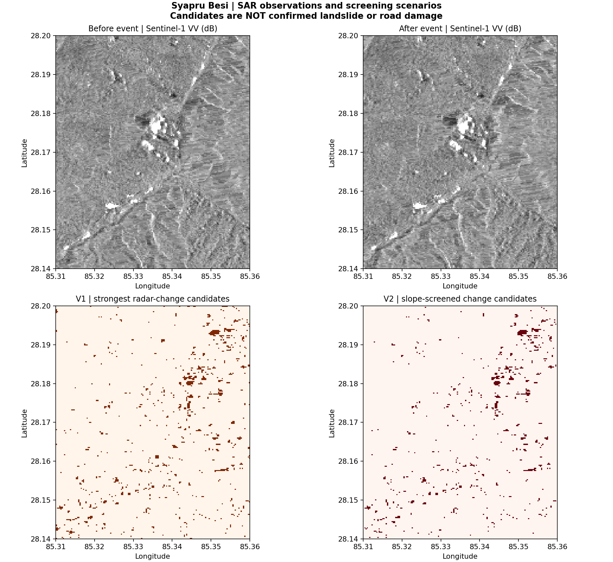
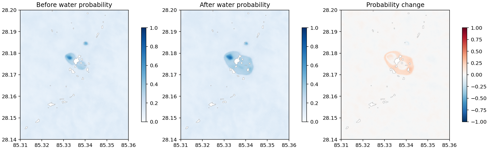
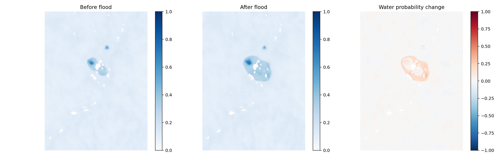
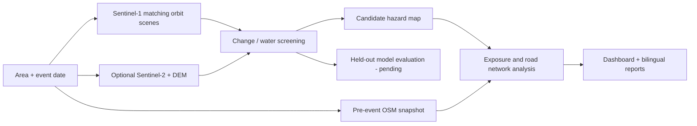

# 🌊 FloodTrack
### Satellite flood screening, infrastructure exposure & settlement accessibility

**Multimodal AI Hackathon 2026 · Track B: Mapping Flood Damage from Space**

FloodTrack is an **educational geospatial research prototype** that compares pre- and post-event satellite observations, screens historical OpenStreetMap infrastructure for exposure, and estimates *possible* road-network disconnections. It produces a map, structured metrics, and situation reports in English and Nepali.

> **Evidence disclaimer:** FloodTrack is not an operational warning service. A radar-change candidate is not automatically a flood, a destroyed building, or a closed road. Results are screening estimates, not ground observations.

## 🔎 Satellite evidence gallery

The following images are **generated analysis figures from the uploaded Syapru Besi case-study export**, not stock photographs or official disaster maps. They visualize different analyses and **must not be combined as if they were one validated flood-damage prediction**.

### 1. Sentinel-1 before/after and radar-change screening



*Top: before/after Sentinel-1 VV backscatter. Bottom: V1/V2 radar-change candidates. These are unverified screening candidates, not confirmed landslide or road damage.*

### 2. AI water-probability diagnostic



*Pre-event/post-event water-probability estimates and difference. The model outputs shown here are separate from the threshold-based primary flood mask and have not been independently verified on this case study.*

<details>
<summary>View alternative AI comparison figure</summary>



*Diagnostic visualization only; independent Nepal validation is pending.*
</details>

## 🧭 Workflow



## ✨ Capabilities and current status

| Component | Current status |
|---|---|
| Same-orbit Sentinel-1 pre/post discovery and processing | Implemented; live data relies on CDSE credentials and quota |
| Optional cloud-masked Sentinel-2 and DEM | Implemented as optional inputs |
| Historical pre-event OSM infrastructure | Implemented, including Geofabrik fallback for the configured case |
| Water candidate mask and polygon export | Implemented as a transparent, threshold-based baseline |
| Buildings, bridges, roads, network connectivity screening | Implemented, *not* field-verified |
| Bilingual situation reports | Implemented; map-grounded deterministic answers |
| Trainable U-Net code | Available; not automatically a validated model |
| Independent Himalayan AI validation | **Pending** in this export |
| Official EMSR927 comparison | Reference is for post-hoc checking only; report confirmed metrics when available |
| Generalized live operation for any AOI | **Not yet demonstrated**; small-AOI constraints apply |

### Example output: Syapru Besi (26 August 2026 event date)

The included **primary threshold-baseline run** reported the following, which are **not** independently confirmed disaster totals:

| Metric | Recorded value |
|---|---:|
| Candidate flood area | **0.0 km²** |
| Buildings flagged by primary mask | 0 |
| Bridges flagged by primary mask | 0 |
| Road length flagged by primary mask | 0 km |
| Possible cut-off settlements in primary mask | 0 |
| Valid Sentinel-1 pixel overlap | 99.18% |

The **separate V1/V2 radar-change experiment** found additional candidate pixels and possible infrastructure overlaps; that does **not** resolve the baseline's zero-area result or establish confirmed flood damage. The separate AI comparison is an exploratory diagnostic with validation pending. See the `outputs/Syapru_Besi_AOI01/` directory in the **full downloadable local export** for detailed provenance. That directory is normally excluded from GitHub commits by `.gitignore`; the published screenshots live instead in `docs/images/`.

## 🚀 Quick start

**Repository setup note:** These commands require the complete source tree (`src/`, `scripts/`, `config/`, `tests/`, and `dashboard/`), not just the short README and figures. If those directories are absent from GitHub, upload the source from the full project ZIP before trying to run it.

Requires Python 3.10+ (recommended) and a suitable environment for scientific geospatial libraries.

```bash
git clone https://github.com/jahin-7/FloodTrack.git
cd FloodTrack
python -m pip install -r requirements.txt
pytest -q tests
python scripts/run_pipeline.py --config config/smoke_test.yaml
streamlit run dashboard/app.py
```

The smoke test uses **synthetic input**, so its map and measurements **must not be described as observed Nepal flood evidence**. The dashboard lists local completed runs and labels synthetic results clearly.

### Run on real Copernicus satellite data

Create a free [Copernicus Data Space](https://dataspace.copernicus.eu/) account and Sentinel Hub OAuth client. Store the **OAuth client ID and secret** in environment variables; do not put credentials in Git or screenshots.

```bash
export CDSE_CLIENT_ID="your-client-id"
export CDSE_CLIENT_SECRET="your-client-secret"
python scripts/check_cdse_catalog.py --config config/case_study.yaml
python scripts/download_inputs.py --config config/case_study.yaml
python scripts/run_pipeline.py --config config/staged_example.yaml
streamlit run dashboard/app.py
```

On Windows PowerShell, replace `export NAME="..."` with `$env:NAME="..."`. Confirm `name`, `bbox`, event date, and the matching staged-input config before processing. CDSE rate limits and API availability apply. See [Colab](COLAB_STEP_BY_STEP.md), [Kaggle](KAGGLE_STEP_BY_STEP.md), and the [technical implementation](docs/TECHNICAL_IMPLEMENTATION.md).

## 🖥️ Dashboard

The enhanced Streamlit interface includes an interactive hazard/exposure map, case metrics, satellite-evidence images when available, assumptions, English/Nepali reports, and downloadable outputs. It never silently interprets zero detected area as proof that no disaster occurred.

## 📁 Project layout

```text
FloodTrack/
├── dashboard/               # Streamlit interface
├── src/floodtrack/          # Acquisition, mapping, ML, reporting
├── scripts/                 # Pipeline, training, validation, utilities
├── config/                  # Case, staged, synthetic settings
├── docs/images/             # Lightweight figures shown in this README
├── notebooks/               # Colab and Kaggle runbooks
├── tests/                   # Offline QA and mock API tests
├── data/                    # Local input data (normally gitignored)
└── outputs/                 # Generated results (normally gitignored)
```

## 🧪 Validation and limitations

- **Verification:** `pytest -q tests` passed all 14 provided tests in an offline review of the uploaded project ZIP; this is not a live Copernicus integration test.
- **Radar:** terrain layover/shadow, relief, speckle, water under vegetation, and seasonal changes can confuse SAR change detection.
- **Model:** train and test on geographically independent sites; publish held-out IoU/F1 and provenance before claiming generalization to Nepal.
- **Connectivity:** an OSM edge intersecting candidate water is not necessarily impassable. Unmapped roads/bridges, crossings, snap tolerance, and AOI boundaries limit reachability claims.
- **Data leakage:** do **not** use EMSR927, UNOSAT, later OSM edits, or other official post-event maps as training/selection inputs; use reference maps only for post-hoc evaluation.
- **Speed:** Sentinel revisits mean FloodTrack cannot predict a glacier collapse minutes ahead; all outputs are delayed observations.

## 📚 Data credits

- **Sentinel:** Contains modified Copernicus Sentinel data 2026.
- **Copernicus DEM:** Produced using Copernicus WorldDEM-30 © DLR e.V. 2010–2014 and © Airbus Defence and Space GmbH 2014–2018 provided under COPERNICUS by the European Union and ESA; all rights reserved. *(Text required by the supplied hackathon brief; confirm the attribution of each DEM product actually used.)*
- **OpenStreetMap:** © OpenStreetMap contributors. Historical pre-event data are used for the scenario.
- **Training resources:** Kuro Siwo — Bountos et al. (2024); Sen1Floods11 — Bonafilia et al. (2020), if used. Check each dataset's license and actual provenance before redistribution.

**Source policy:** See [the hackathon data-source rules](docs/SOURCE_LINKS_AND_RULES.md). Do not reuse Copernicus EMS reference polygons as model inputs.

## 📄 Deliverables

The original hackathon calls for a working map dashboard, one-page situation report, a maximum six-page written report, a three-minute demonstration, transparent limitations, data attribution, and independent EMSR927 comparison. The code and templates are present; **not all evaluation deliverables are finalized**.

---

*Research prototype — not for operational disaster response.*
